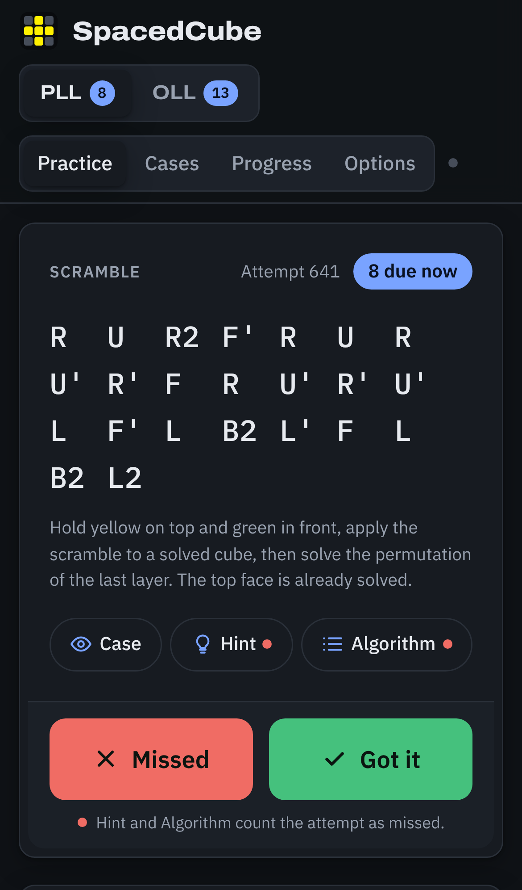
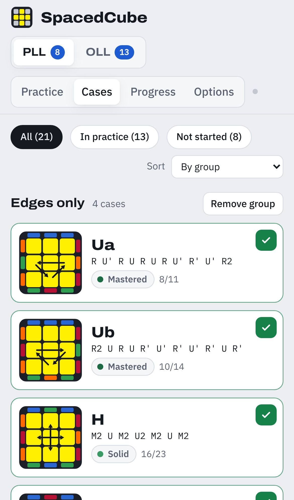
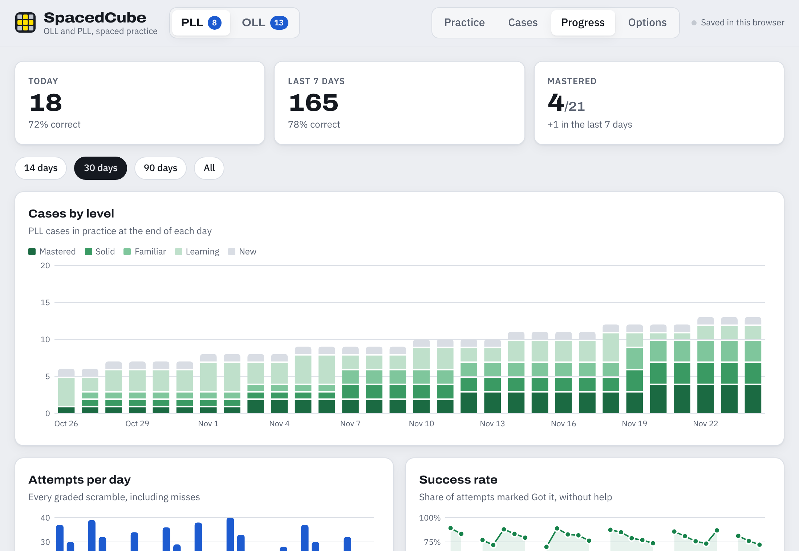

# SpacedCube

A spaced-practice trainer for the last layer of the 3x3 cube: all 57 **OLL** cases and all 21 **PLL** cases.

It gives you a scramble that produces a case from a solved cube, you solve it, and you say whether you got it. The trainer adapts how often each case comes back: weak cases come up often, cases you know well come back rarely but still often enough to check you have not forgotten them. New cases are added a few at a time as earlier ones become solid.

**Use it at [spacedcube.app](https://spacedcube.app)**: free, no account needed, works offline once loaded. Install it from the browser to get a full-screen app on your phone.

<p>
  
  
</p>
<p></p>

It is a static web app: it installs full screen on a phone, works offline, and can sync between devices through a Supabase project (optional). Without a sync server it keeps everything in the browser.

## Features

- **Case picker.** First run: tick the cases you already kind of know; they start in rotation, the rest are introduced in a learning order.
- **Scrambles generated from the algorithms.** A sticker-level cube simulator inverts the algorithm and, by default, disguises the scramble (OLL: random last-layer permutation; PLL: combination of two other PLLs that lands on the target case), so the case cannot be recognised from the moves. Every scramble is checked in the simulator before it is shown.
- **Diagrams computed from the algorithms.** OLL: top face and side stickers. PLL: side colours and permutation arrows.
- **Help that counts honestly.** Help chips under the scramble: the case (free), hints one move at a time, or the full algorithm. Hints and the algorithm turn the attempt into a miss, marked on the chip and explained under the grade buttons, with a confirmation first.
- **No accidental double grades.** After Got it or Missed the result stays on screen and a Next scramble button takes the place of the grade buttons, so tapping Got it again after restoring the cube grades nothing (Options, On this device: Pause after each grade).
- **3D replay.** Plays the solution on a 3D cube starting from your actual scramble (three.js, loaded on first use).
- **Speed practice, after memorisation.** Once every case of a set is Mastered, a Memory / Speed switch appears on the practice screen. In Speed you look at the case, start the timer, solve and stop it, so only the solve is timed. Each case gets a speed level from its turns per second, the slowest cases come up most, and speed work never changes a memory level unless the case was due or you missed it.
- **Practise a chosen case.** "Practise it now" in a case's details gives one scramble of that case (adding it to practice if needed). It is a normal attempt, graded and scheduled like any other; it just skips recognition.
- **Custom algorithms.** Checked against the case before saving; a leading `y` rotation is hidden and the diagram is turned to match.
- **Cases view.** Grouped like jperm.net, or sorted by weakest first / most recent misses.
- **Progress view.** Daily attempts, success rate and cases by level, with a table view.
- **What is due, at a glance.** Each set button in the header shows how many cases are due, the practice screen shows "N due now" or when the next case comes due, the tab title carries the count, and an installed app shows it as an icon badge where the system supports it (Badging API). Counts refresh every minute.
- **Data.** Local storage first, optional sync, backup code export/import (a code restores into the set it came from).
- **Accessible.** Works with the keyboard and screen readers: skip link, one heading per view with focus moved to it, focus kept on the same control after every update, modal dialogs that make the page behind inert and return focus, results and errors announced in a live region, text alternatives for diagrams and a table for the charts, single-key shortcuts that can be turned off, reduced motion respected. axe-core checks every screen against WCAG 2.2 A and AA in both colour schemes.
- **Private by default.** No ads, analytics or third-party requests: fonts and three.js are served by the app. Cloudflare Turnstile loads only once someone starts signing in.

## Repository layout

```
src/index.html         Page shell (no inline script or style).
src/css/               base.css (tokens, layout, header, buttons) and one file per view.
src/js/core/           No DOM, runs in Node too:
  cube.js                sticker model and moves
  notation.js            parsing, formatting, face-turn translation
  inspect.js             reading a state: solved, OLL pattern, PLL case, arrows
  cases-oll.js           the 57 OLL cases
  cases-pll.js           the 21 PLL cases
  scheduler.js           levels, gaps, buckets
  speed.js               turns in an algorithm, timed solves, speed levels
  case-set.js            a case set built from its definition: scrambles, checks, scheduling
  schema.js              version of the saved state and the steps that upgrade it
  index.js               public API
src/js/app/            The UI, as small ES modules:
  state.js               shared state S, local storage, save, set switching
  env.js                 deployment settings from config.js
  supabase.js, sync.js   sync server client and newest-wins sync
  captcha.js, account.js Turnstile check and sign-in
  practice.js, cases.js, progress.js, charts.js, options.js   the views
  timer.js               the Speed timer (start, stop, false start)
  due.js                 due counts: header badges, title, app icon badge
  diagrams.js            case diagrams and labels
  colors.js              sticker colours, shared by the diagrams and the 3D viewer
  dialog.js, modal.js    case dialog and shared modal behaviour
  viewer3d.js            3D replay
  render.js, actions.js, keys.js   rendering, click and keyboard handling
src/js/main.js         Entry point: wires the modules and starts the app.
src/privacy.html       Privacy page template (filled in by the build).
docs/screenshots/      Screenshots for this README.
src/sw.js              Service worker (file list and version filled in by the build).
src/fonts/, src/vendor/  Self-hosted fonts and three.js, with their licences.
src/types.d.ts         Types of the few globals the app reads (for the type check).
tools/icons.mjs        Draws the app icons (Node standard library only).
supabase/schema.sql    Table, row-level security, grants and delete_my_account() for sync.
build.mjs              Copies src/ to dist/ and generates config.js, the CSP, the footer, module preloads, privacy.html, icons and sw.js.
tests/unit/            node:test unit tests: scheduler, speed, saved-data versions, state, sync.
tests/unit/core.test.js  Every case and scramble checked in the simulator.
tests/e2e/             Browser tests (Playwright Test): every screen with axe, keyboard and focus, offline and sync
                       against a mock sync server. playwright.config.mjs runs them in Chromium, Firefox and WebKit.
eslint.config.js, tsconfig.json   Lint and type check (plain JavaScript, checked with JSDoc).
```

There is no bundler and no runtime dependency: the browser loads the modules directly (the build lists them as `modulepreload` links so they download in parallel). `package.json` only holds the check and test tools.

## Build and test

```sh
npm install                      # once: Playwright, axe-core, eslint, typescript
npx playwright install           # once: the browsers for the tests

npm start                        # build and serve at http://localhost:8000
npm test                         # everything: lint, type check, unit tests, browser tests in 3 engines
npm run check                    # the quick part: lint, type check, unit tests
npx playwright test --project=webkit   # browser tests in one engine
npm run build                    # -> dist/ (settings from environment variables, see below)
```

The browser tests run in Chromium, Firefox and WebKit (WebKit is what every browser on an iPhone uses). `CHROME=/path/to/chrome` makes Chromium use another binary. They fail on any page error, unrendered placeholder, accessibility violation or Content Security Policy violation. Only Node is needed: no Python, no bundler.

## How it works

### Cube model (`src/js/core/`)

54 stickers, each with a position and normal in `{-1,0,1}^3` (x = R, y = U, z = F). Every move (faces, wide moves, slices, rotations) is a quarter-turn rotation of the stickers selected by a layer predicate, so the same code handles `R`, `r`, `M`, `x`. Any algorithm can be translated to outer face turns relative to fixed centres (`toFaceTurns`), which is what scrambles use.

### Case sets

`makeSet(def)` builds a case set from a definition: groups, `[id, group, algorithm]` rows, learning order. For each case it derives the face-turn sequence, the diagram data and the set of keys that identify the case from any angle and AUF. These keys are how scrambles and custom algorithms are verified.

- OLL algorithms and case numbers follow [jperm.net/algs/oll](https://jperm.net/algs/oll).
- PLL algorithms are the widely used standard set. A closing U turn was added to Z, Ja, Jb, Ra and Rb so the algorithm ends solved and the arrows show the true permutation.

### Scheduling

Each case has a level 0-10. Buckets: 0 New, 1-2 Learning, 3-4 Familiar, 5-6 Solid, 7+ Mastered.

- **Miss:** level drops to about half (`min(level-2, floor(level/2))`).
- **Correct:** level rises by one **only if enough time has passed since the case was last seen** (`GAP_MS`): none for 0->1 and 1->2, then 10 min, 8 h, 1 d, 2 d, 4 d, 7 d, 14 d, 30 d. A correct answer while the case is still in short-term memory is recorded but does not raise the level. Reaching Mastered takes at least about a week of spaced successes.
- **Due:** levels 0-1 are due after a few other attempts; from level 2 a case is due once its gap has passed (`dueRatio`).
- **Picking:** weighted random, weight = `dueRatio^2` x a factor for a weak recent record (last 20 results, smoothed) x a small boost for cases with few attempts. The last case (and the one before, with 5+ active) is never shown twice in a row.
- **New cases:** a new case joins whenever fewer than `pool` cases (default 3) are below the "learned" level (a setting: Familiar, Solid or Mastered; default Solid, which needs a correct answer after a gap of at least a day).

These rules came from looking at real practice data: with promotions counted on every correct answer, 31 OLL cases reached level 10 within a week and half of all attempts went to cases never missed.

### Speed

Speed practice opens for a set once every case is Mastered (`speedOpen` in the state; it stays open). Only Mastered cases are timed: one that drops below goes back to memory practice until it is Mastered again.

- **Timing:** the case is recognised before the timer starts, so the time is the execution only (recognition gets its own drill later, see issue #3). Start and stop react on pointerdown; a stop within 250 ms of the start is ignored.
- **Turns:** the moves of your algorithm as written (custom or standard), every face, wide or slice move counting one and a half turn too; rotations do not count.
- **Speed level:** the median turns per second of the last 5 timed solves, rounded down, once a case has 3. Level 4 means at least 4 turns per second. The last 12 times are kept (`times`, `[ms, turns]` pairs).
- **Picking:** a case due for its memory review comes first, and the timed solve counts as that review. Otherwise a Mastered case, weighted by 1/tps² (untimed cases as if at 2 turns per second), never the last two shown.
- **Memory levels:** a correct timed solve of a case that is not due changes nothing for memory (not even the time since it was last seen). A miss counts for memory as usual. Hints and the algorithm still make the attempt a miss, and the time is not kept.

### Saved-data versions

Every saved state carries `v`, the format version (`src/js/core/schema.js`). Older states are upgraded step by step when read. A state written by a newer version of the app (synced from another device, or a backup code) is never read or overwritten: sync stops for that set and the app asks to reload, which installs the update.

### Persistence and sync

State per set (`oll-trainer-v1`, `pll-trainer-v1` in localStorage) is one JSON object: settings, per-case stats (`level`, `n`, `ok`, `hist` of the last 20 results, `last` attempt number, `lastTs`, `lastMiss`, `times` of the last 12 timed solves), custom algorithms and a daily log for the charts (two years kept). Every change is written locally at once and, when signed in, uploaded about 1.5 s later. On load, when the tab becomes visible and when the connection comes back, the newer copy (by `updatedAt`) wins. Whole-state, last writer wins: no per-attempt merge.

Sync uses the `progress` table of the configured Supabase project, one row per user and set. The client is a few plain `fetch` calls (auth and PostgREST), so nothing extra is loaded. The session (access and refresh token) is kept in localStorage under `ll-trainer-auth`.

## Deploying your own copy

`.github/workflows/pages.yml` runs every test, then builds the app with the repository's settings and publishes `dist/` to GitHub Pages on each push to `main` (pull requests run the tests only). Any static host with HTTPS works too: run `node build.mjs` with the same environment variables and upload `dist/`.

Nothing specific to a deployment lives in the code. The build reads these environment variables; in GitHub, set them as repository variables (Settings > Secrets and variables > Actions > Variables). All are optional and public by nature (they end up in the page):

| Variable | Meaning |
|---|---|
| `SUPABASE_URL` | `https://<project>.supabase.co`. Without it, no sync: progress stays in the browser. |
| `SUPABASE_PUBLISHABLE_KEY` | The project's publishable key (or legacy anon key). |
| `ALLOW_SIGNUP` | `true`: an unknown email creates an account on first sign-in. |
| `TURNSTILE_SITE_KEY` | Cloudflare Turnstile site key for the sign-in form. |
| `PRIVACY_OPERATOR` | Who runs this copy, for the privacy page. |
| `PRIVACY_CONTACT_EMAIL` | Address for privacy requests. |
| `PRIVACY_DATA_LOCATION` | Where Supabase stores the data, e.g. `Servers in Ireland (EU).` |
| `PRIVACY_EMAIL_PROVIDER` | Who sends the sign-in emails, e.g. `Brevo (EU)`. |
| `PRIVACY_HOSTING` | Who hosts the files (default: GitHub Pages). |
| `STAGING` | `true` for a test copy: a Staging tag in the header and test tools in Options (for example making every case Mastered to try Speed). |
| `REPOSITORY_URL` | Source code link in the page footer. In GitHub Actions it defaults to the repository being built. |

Set the custom domain, if any, in the repository's Pages settings.

The build turns the same settings into a Content Security Policy (a `<meta>` tag, since GitHub Pages cannot send headers): scripts and connections only to the site itself, the configured Supabase project and, when a site key is set, Cloudflare Turnstile. No inline scripts, no `eval`.

The app caches itself on the first visit and then works offline. On a phone use "Add to Home Screen" (iOS Safari) or "Install app" (Android Chrome); it opens full screen and respects the notch and home indicator. When a new version is deployed, an open app offers to reload.

### Accounts

With `ALLOW_SIGNUP`, the sign-in email creates the account on first use. Sign-in is by a 6-digit code or a link in the same email. An app installed on an iPhone does not share storage with Safari, so a link opened from the mail app signs in Safari, not the installed app; typing the code works everywhere. The Turnstile check keeps bots from creating accounts and burning the email quota. Options > Your data > Delete account removes the sign-in and the synced rows; progress in the browser stays. What is stored is described on `/privacy.html`.

Each state is capped at 256 KB by the database; a heavy user is about 50 KB.

### Setting up a sync server (once)

1. Create a project at [supabase.com](https://supabase.com). SQL editor: run `supabase/schema.sql` (table, row-level security `user_id = auth.uid()`, size limit, no access for the anon role, `delete_my_account()`).
2. An email provider with SMTP: authenticate your domain there (DKIM, DMARC), then Authentication > Emails > SMTP Settings. Supabase's built-in sender only mails members of your Supabase team, and on the free plan the email templates can only be edited once custom SMTP is on.
3. Authentication > Emails: put `{{ .Token }}` in the Magic Link and Confirm signup templates so the email contains the code. Authentication > Providers > Email: 6-digit codes.
4. Authentication > URL Configuration: Site URL and Redirect URLs set to where the app is served.
5. Cloudflare dashboard > Turnstile: add a widget for your hostnames (Managed mode). Set `TURNSTILE_SITE_KEY` and deploy. Then Authentication > Attack Protection: enable CAPTCHA protection, provider Turnstile, with the widget's **secret key**. Keep this order: once Supabase requires the check, an app without the site key can no longer sign in.
6. Authentication > Sign In / Providers: allow new users to sign up (only after step 5) and set `ALLOW_SIGNUP=true`. Leave both off if accounts should only be created by you (Authentication > Users > Add user).
7. Project Settings > API: set `SUPABASE_URL` and `SUPABASE_PUBLISHABLE_KEY`, and the `PRIVACY_*` variables, then deploy.

The publishable key and the Turnstile site key are public by design; the row-level security policy is what keeps each user's rows private, and the Turnstile secret stays in Supabase.

### Moving progress between copies

Options > Show backup code (once per set), then Options > Restore from backup in the other copy. The code is restored into the set it belongs to and synced once you sign in.

## Testing before deployment

Larger changes are tried on a staging copy before they reach `main`. Staging has its own address and its own Supabase project, for three reasons:

- Local storage and the service worker belong to the address. A test build under the live site (say `/next/`) would read and upgrade your real progress, and the live service worker would serve its cached files in place of the new ones.
- Sync is whole-state, newest wins. A test build syncing to the live project could upload a state in a newer format, which the live app then refuses and stops syncing.
- Installing the app and offline mode need HTTPS, so a phone cannot test them against `npm start` on a laptop.

A Cloudflare Worker serves the `staging` branch at a fixed address and gives every other branch a preview address; GitHub Pages keeps publishing `main` as before.

### Setting up staging (once)

1. A second Supabase project (the free plan allows two). SQL editor: run `supabase/schema.sql`. Leave sign-ups off and add yourself under Authentication > Users; the built-in email sender is enough, since it mails members of your Supabase team.
2. Push a branch named `staging` (`git push origin main:staging`): Cloudflare can only pick a branch that exists.
3. Cloudflare dashboard > Workers & Pages > Create > Import a repository: this repository. Build command `npm run build`. Deploy command `npx wrangler deploy --assets=dist --name=spacedcube --compatibility-date=2026-11-01`. Preview command `npx wrangler versions upload --assets=dist --name=spacedcube --compatibility-date=2026-11-01`. The repository has no wrangler configuration, so the commands name the folder, the Worker and the date. Keep this preview command if Cloudflare offers to switch to "Worker Previews".
4. Build settings: production branch `staging` (not `main`: GitHub Pages is the live copy), builds for non-production branches on. Settings > Build > Variables and secrets (build variables: the app reads them while building, so the Worker's runtime variables have no effect): `NODE_VERSION` = `22`, `SUPABASE_URL` and `SUPABASE_PUBLISHABLE_KEY` of the staging project, `REPOSITORY_URL`, `STAGING` = `true`, and `PRIVACY_HOSTING` = `Cloudflare (United States, under the EU-US Data Privacy Framework)` with the other `PRIVACY_*` values. No `TURNSTILE_SITE_KEY` and no `ALLOW_SIGNUP`, unless the change is about signing in; then add the staging hostname to the Turnstile widget and set both.
5. The Worker's Settings > Domains & Routes: turn on preview URLs, so branches get their own address.
6. Supabase, Authentication > URL Configuration: Site URL and Redirect URLs set to the Worker's address, `https://spacedcube.<your-subdomain>.workers.dev`. Install that address on your phone.

### Trying a change

1. Work on a branch, run `npm test`, then push the branch to `staging` (`git push -f origin HEAD:staging`). Cloudflare rebuilds the staging address in about a minute; it keeps its storage, sign-in and installed app between builds.
2. Try the change there, on the phone too.
3. Changing the saved-state format: in the live app use Options > Show backup code, restore it on staging, then sign in, so the upgrade step runs on real progress.
4. Merge into `main`: the workflow tests again and publishes to GitHub Pages.

Every other pushed branch also gets a preview address (in the Cloudflare build log), which starts with empty storage and shows what a new user sees. Signing in there needs `https://*-<worker>.<your-subdomain>.workers.dev/**` in the staging project's Redirect URLs.

## Credits and licences

- OLL algorithms and numbering as listed on [jperm.net](https://jperm.net/algs/oll); diagrams, scrambles and all code are original.
- [three.js](https://threejs.org) r128 (MIT) for the 3D viewer, in `src/vendor/`.
- Fonts: Archivo, IBM Plex Sans, IBM Plex Mono (SIL Open Font License 1.1, latin subset from Fontsource), in `src/fonts/`.
- [axe-core](https://github.com/dequelabs/axe-core) (MPL 2.0) runs in the tests only.
- SpacedCube itself: [MIT](LICENSE). Contributions: see [CONTRIBUTING.md](CONTRIBUTING.md). Security problems: see [SECURITY.md](SECURITY.md), please not in public issues.
